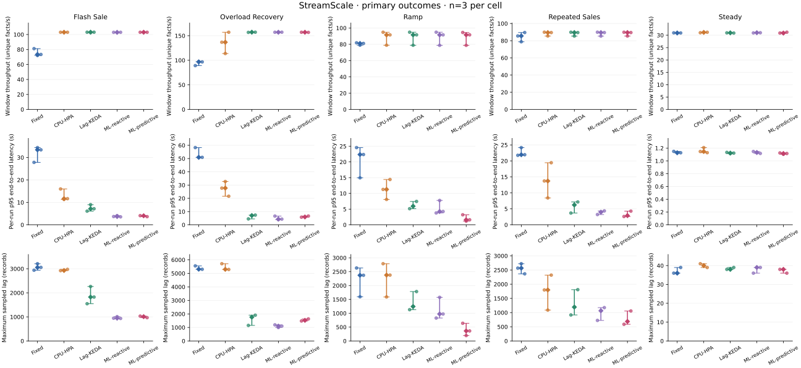
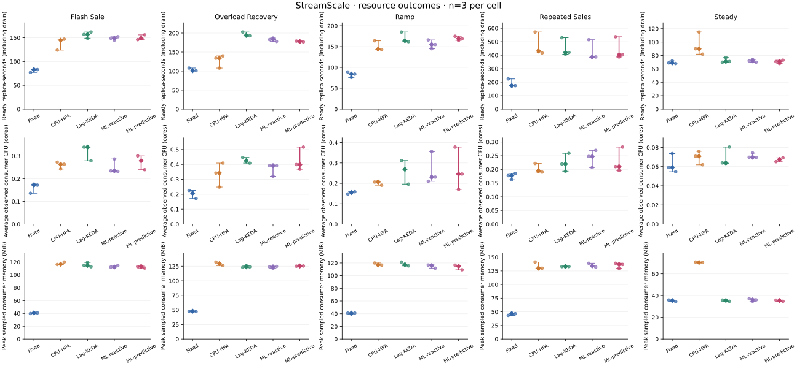
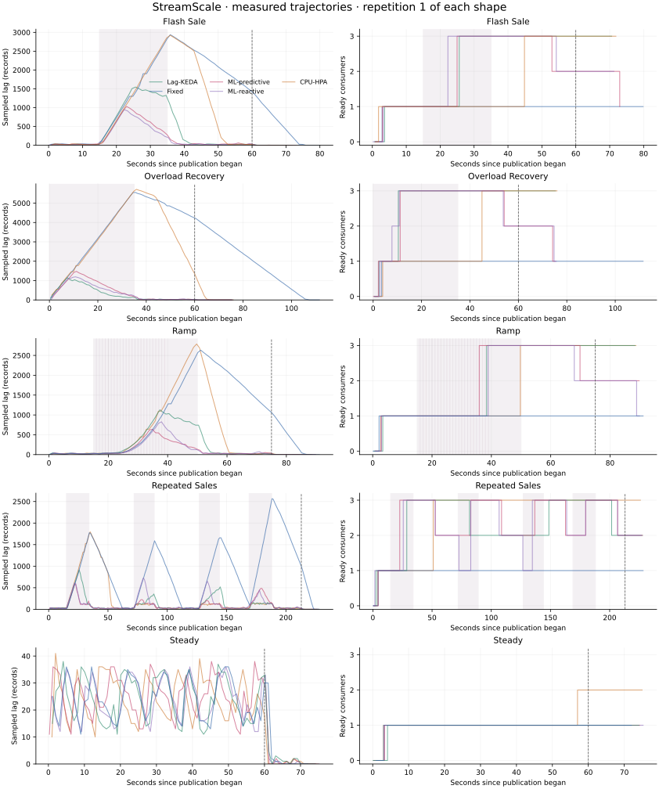

# StreamScale M16 measured results: ML predictive autoscaling

Campaign `campaign-20261028T225554-fc5dec` completed 2026-10-29T03:22:06.258031Z. All **75 measured runs** passed acknowledgement/SQL/DLQ reconciliation before and after a controlled restart. Excluded attempts in this campaign: **0**. The independent audit verified 12,049 raw samples.

Protocol **v3**: pilot capacity 83.77 accepted events/s; steady **32**/s, surge **250**/s. 5 modes × 5 scenarios × 3 repetitions in seed-4343 randomized order. Ramp and repeated-sales shapes vary by repetition from reserved `eval:*` seeds; every mode in a repetition sees the same logical sequence.

**Modes.** ML-predictive forecasts the peak arrival rate in four windows over the next 20 s (quantile 0.6 gradient-boosted trees, sha256 `1c5304befb48…`, trained on `train:0..train:699` in a simulator calibrated against M7) and adapts its bias, per-consumer capacity and pod-start delay online. ML-reactive is the ablation: the same one-second planner and actuation, assuming the current arrival rate continues and learning nothing. Both choose the fewest consumers whose predicted queueing delay stays within 3 s, using frozen capacity 83.77/s per consumer. Neither can read the run schedule. Fixed, CPU-HPA and Lag-KEDA keep their M7 settings.

Values are **median [minimum, maximum] across repetitions**. No confidence interval or statistical significance is claimed.

| Scenario | Mode | Run p95 latency (s) | Max sampled lag | Ready replica-s | Ready at sale start | Sale response (s) | Scale changes |
| --- | --- | ---: | ---: | ---: | ---: | ---: | ---: |
| flash-sale | Fixed | 33.43 [27.83, 34.42] | 3055 [2939, 3209] | 83 [77, 83] | 1.00 [1.00, 1.00] | unobserved | 0 [0, 0] |
| flash-sale | CPU-HPA | 11.67 [11.33, 15.98] | 2928 [2922, 2975] | 145 [124, 147] | 1.00 [1.00, 1.00] | 22.1 [20.2, 29.9] | 1 [1, 1] |
| flash-sale | Lag-KEDA | 7.16 [6.11, 8.99] | 1824 [1547, 2263] | 157 [149, 162] | 1.00 [1.00, 1.00] | 15.7 [10.6, 17.3] | 1 [1, 1] |
| flash-sale | ML-reactive | 3.70 [3.56, 4.09] | 946 [935, 1011] | 149 [145, 152] | 1.00 [1.00, 1.00] | 9.2 [7.3, 10.0] | 2 [2, 3] |
| flash-sale | ML-predictive | 4.04 [3.66, 4.09] | 1010 [969, 1032] | 149 [146, 156] | 1.00 [1.00, 1.00] | 9.7 [7.0, 10.0] | 3 [2, 3] |
| overload-recovery | Fixed | 50.93 [50.91, 58.28] | 5310 [5301, 5553] | 101 [101, 108] | unobserved | unobserved | 0 [0, 0] |
| overload-recovery | CPU-HPA | 27.72 [21.60, 32.69] | 5298 [5288, 5713] | 134 [108, 140] | unobserved | unobserved | 1 [1, 1] |
| overload-recovery | Lag-KEDA | 7.02 [4.50, 7.34] | 1763 [1150, 1908] | 194 [193, 203] | unobserved | unobserved | 1 [1, 1] |
| overload-recovery | ML-reactive | 4.32 [3.95, 6.61] | 1099 [993, 1192] | 183 [178, 187] | unobserved | unobserved | 3 [3, 3] |
| overload-recovery | ML-predictive | 5.94 [5.78, 6.64] | 1527 [1477, 1631] | 178 [177, 179] | unobserved | unobserved | 3 [2, 3] |
| ramp | Fixed | 22.36 [14.94, 24.56] | 2371 [1594, 2633] | 84 [76, 89] | 1.00 [1.00, 1.00] | unobserved | 0 [0, 0] |
| ramp | CPU-HPA | 11.26 [8.07, 14.42] | 2378 [1588, 2788] | 144 [143, 164] | 1.00 [1.00, 1.00] | 34.8 [30.9, 41.8] | 1 [1, 1] |
| ramp | Lag-KEDA | 5.93 [5.14, 7.44] | 1244 [1130, 1783] | 164 [162, 185] | 1.00 [1.00, 1.00] | 24.4 [23.4, 30.8] | 1 [1, 1] |
| ramp | ML-reactive | 4.23 [3.78, 7.76] | 974 [827, 1575] | 155 [145, 166] | 1.00 [1.00, 1.00] | 23.9 [22.8, 24.4] | 2 [2, 3] |
| ramp | ML-predictive | 1.61 [1.18, 3.20] | 362 [195, 639] | 169 [165, 175] | 1.00 [1.00, 1.00] | 18.1 [14.5, 20.9] | 3 [2, 3] |
| repeated-sales | Fixed | 21.94 [21.75, 24.17] | 2567 [2366, 2722] | 174 [174, 224] | 1.00 [1.00, 1.00] | unobserved | 0 [0, 0] |
| repeated-sales | CPU-HPA | 13.72 [8.42, 19.43] | 1798 [1088, 2321] | 431 [417, 572] | 2.33 [2.33, 2.50] | 36.0 [29.0, 41.6] | 1 [1, 1] |
| repeated-sales | Lag-KEDA | 6.23 [3.69, 7.16] | 1194 [916, 1808] | 420 [407, 530] | 2.00 [2.00, 2.25] | 18.0 [17.7, 19.6] | 3 [3, 4] |
| repeated-sales | ML-reactive | 3.97 [3.22, 4.36] | 1065 [724, 1175] | 387 [385, 515] | 1.50 [1.33, 1.67] | 10.2 [9.9, 10.9] | 8 [8, 11] |
| repeated-sales | ML-predictive | 2.88 [2.61, 4.29] | 687 [588, 1057] | 403 [387, 537] | 1.67 [1.67, 1.75] | 10.1 [9.7, 10.6] | 7 [6, 8] |
| steady | Fixed | 1.13 [1.13, 1.15] | 36 [36, 39] | 69 [68, 72] | unobserved | unobserved | 0 [0, 0] |
| steady | CPU-HPA | 1.15 [1.13, 1.21] | 40 [39, 41] | 90 [82, 115] | unobserved | unobserved | 1 [1, 1] |
| steady | Lag-KEDA | 1.12 [1.12, 1.13] | 38 [38, 39] | 71 [70, 77] | unobserved | unobserved | 0 [0, 0] |
| steady | ML-reactive | 1.13 [1.12, 1.15] | 39 [36, 39] | 72 [70, 74] | unobserved | unobserved | 0 [0, 0] |
| steady | ML-predictive | 1.12 [1.10, 1.12] | 38 [36, 38] | 71 [68, 73] | unobserved | unobserved | 0 [0, 0] |

For **flash-sale**, ML-reactive had the lowest observed median run p95 (3.70 s, 149 replica-s). ML-predictive: 4.04 s and 149 replica-s; ML-reactive: 3.70 s and 149 replica-s; Lag-KEDA: 7.16 s and 157 replica-s.

For **overload-recovery**, ML-reactive had the lowest observed median run p95 (4.32 s, 183 replica-s). ML-predictive: 5.94 s and 178 replica-s; ML-reactive: 4.32 s and 183 replica-s; Lag-KEDA: 7.02 s and 194 replica-s.

For **ramp**, ML-predictive had the lowest observed median run p95 (1.61 s, 169 replica-s). ML-predictive: 1.61 s and 169 replica-s; ML-reactive: 4.23 s and 155 replica-s; Lag-KEDA: 5.93 s and 164 replica-s.

For **repeated-sales**, ML-predictive had the lowest observed median run p95 (2.88 s, 403 replica-s). ML-predictive: 2.88 s and 403 replica-s; ML-reactive: 3.97 s and 387 replica-s; Lag-KEDA: 6.23 s and 420 replica-s.

For **steady**, ML-predictive had the lowest observed median run p95 (1.12 s, 71 replica-s). ML-predictive: 1.12 s and 71 replica-s; ML-reactive: 1.13 s and 72 replica-s; Lag-KEDA: 1.12 s and 71 replica-s.

## How to read the ML comparison

- ML-reactive versus Lag-KEDA mostly measures control-loop speed: a one-second loop that sets replicas directly, against KEDA's 2 s poll plus the HPA's 15 s sync.
- ML-predictive versus ML-reactive isolates the forecast and online learning; the forecast can only add consumers earlier, never remove them sooner.
- Ready at sale start counts consumers already Ready when each sale began, averaged over a run's sales. Sale response is the time from a sale's start to the next rise in ready consumers (missing when none was needed or observed).

## Limitations

- Evaluation shapes come from the same generator and parameter ranges as training, under different seeds. Real traffic is not claimed to follow them.
- The forecaster was trained in a simulator calibrated to M7 medians (±20% or within the measured range); simulator error carries into the model.
- One shared kind node, three repetitions and short windows; carryover, controller cadence and fresh-group startup may affect results. Descriptive only.
- At-least-once delivery; no production, multi-node or exactly-once improvement is claimed. Resource integrals are approximations, not billing.

Image `streamscale:fa2bb34b0d8ce0d1`; Git `a35190b41f5adc01208dfe52562e27313ea6bf16`; dirty build: `False`. Reproduce with `./streamscale.sh experiments-v3 --fresh`, then `./streamscale.sh analysis-v3`. See [M16 evidence](../../m16-evidence.md).
